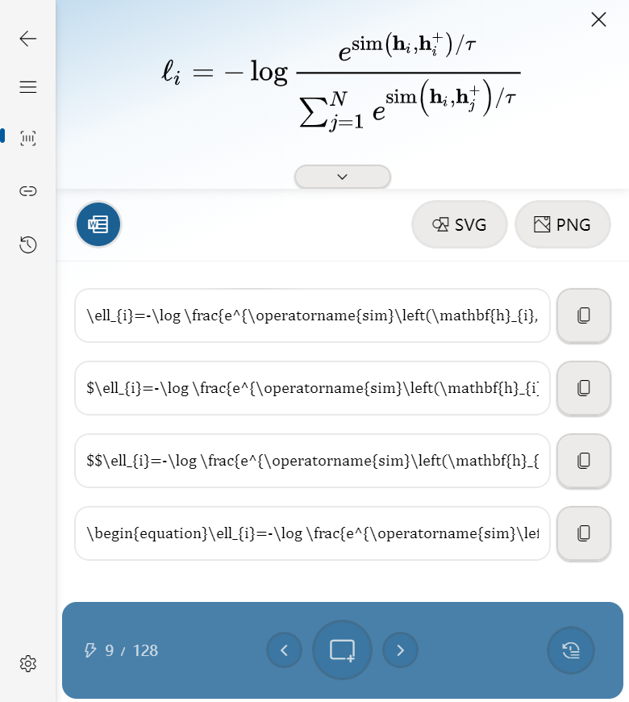
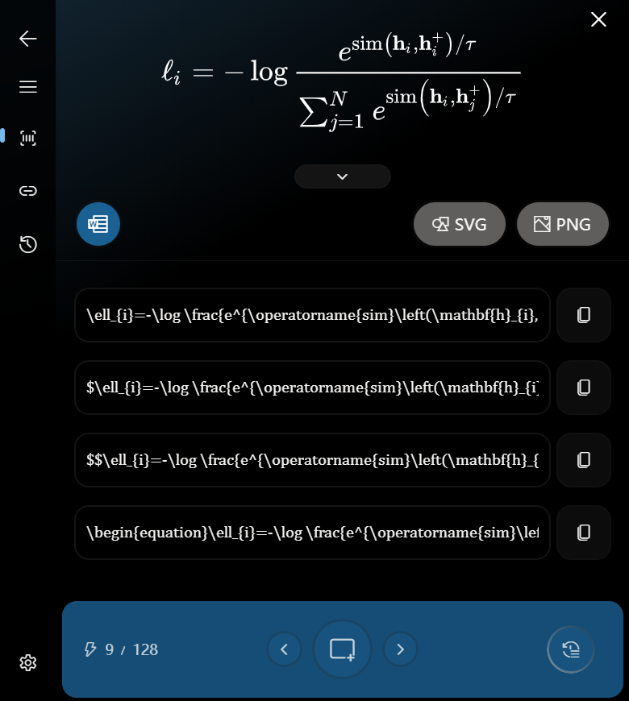
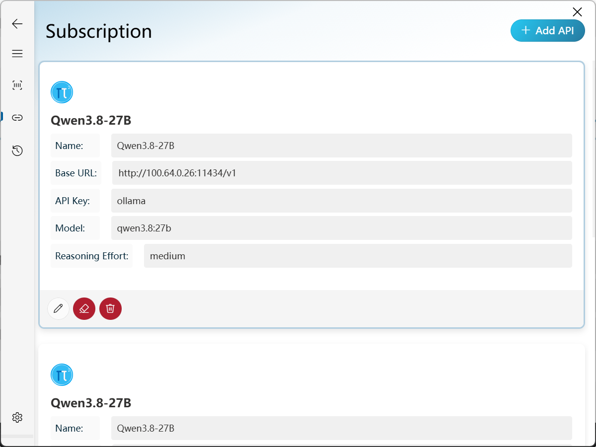

<div align="center">
  
  <h1>MathFX</h1>
  <p>A beautiful, friendly, and minimal formula OCR workspace powered by VLM APIs.</p>
  <p>
    <a href="https://github.com/Creator-SN/MathFX/releases"></a>
    <a href="https://github.com/Creator-SN/MathFX/actions/workflows/release.yml"></a>
    <a href="LICENSE"></a>
  </p>
  <p><a href="./docs/README.zh-CN.md">中文文档</a></p>
</div>

## What is MathFX?

MathFX is a small cross-platform desktop tool for turning mathematical expressions into clean, editable LaTeX. Its core workflow is deliberately simple: capture a formula, let a vision-language model understand it, and copy the result wherever you need it.

It is designed for papers, lecture notes, research workflows, and anyone who wants formula recognition without a crowded interface.

<div align="center">
  
  
</div>

## Highlights

- **Minimal formula OCR** — capture a formula from any screen with a global shortcut and receive editable LaTeX.
- **VLM API based** — use a vision-capable, OpenAI-compatible Chat API instead of being locked to a single OCR vendor.
- **Your provider, your model** — configure a custom display name, base URL, API key, model, and `reasoning_effort` (defaults to `medium`).
- **LangGraph orchestration** — the recognition request is represented as a small LangGraph workflow, making the model call and result parsing explicit and extensible.
- **Manual LaTeX workspace** — edit or enter LaTeX by hand, render it immediately, and keep the corrected result in history.
- **Copy in useful formats** — quickly copy bare LaTeX, inline math, display math, equation-environment LaTeX, rendered SVG, or a raster image for documents and desktop applications.
- **History and navigation** — keep recognized formulas locally, browse previous results, edit them, and remove entries when they are no longer needed.
- **Light and dark themes** — a compact interface that stays out of the way while you work.
- **Windows and macOS releases** — packaged installers are built automatically through GitHub Actions.

## How recognition works

MathFX sends the captured image to the VLM endpoint configured in the selected subscription. The model is instructed to return one JSON object containing KaTeX-compatible LaTeX. MathFX then parses the response and performs rendering, SVG generation, format conversion, and clipboard operations locally.

The default prompt asks the model to preserve fractions, roots, matrices, Greek letters, limits, superscripts, subscripts, aligned equations, operators, and visible text while returning no Markdown or explanation.

Because MathFX uses a VLM API, the selected model must support image input. The endpoint should be compatible with the OpenAI Chat Completions interface, including hosted OpenAI-compatible services and local vision models.

> Images are sent to the API provider configured by you. Review that provider's privacy and retention policy before using sensitive material.

## Quick start

1. Download the latest installer from the [Releases page](https://github.com/Creator-SN/MathFX/releases).
2. Open **Subscriptions** and add a Chat API subscription.
3. Fill in the name, base URL, API key, vision-capable model, and optional `reasoning_effort` (`medium` by default).
4. Select the subscription so its active state is highlighted.
5. Press the scan button or use `Alt + Shift + X` on Windows, or `Alt + Cmd + X` on macOS.

<div align="center">
  
</div>

## Editing and copying formulas

After recognition, the formula can be corrected manually. MathFX renders the edited LaTeX with KaTeX and lets you copy the result in the format that fits the destination:

- plain LaTeX source for editors such as VS Code;
- inline or display LaTeX for Markdown and documentation;
- an equation environment for LaTeX documents;
- rendered SVG for Word and other rich document applications;
- an image for applications that accept bitmap content.

The formula and its source image are kept in the local history store so you can revisit, edit, copy, or delete them later.

## Keyboard shortcuts

- `Alt + Shift + X` on Windows / `Alt + Cmd + X` on macOS — capture a new formula.

## Development

Requirements: Node.js 20+, Yarn 1.x, and a VLM API key for end-to-end recognition.

```bash
yarn install
yarn dev
```

Build the renderer and Electron bundles:

```bash
yarn build
```

Build platform packages locally:

```bash
yarn build:win
yarn build:mac
```

Tagged pushes matching `v*` trigger the GitHub Actions release workflow. Windows produces an NSIS installer; macOS produces DMG and ZIP packages using `Icon.icns`.

## Architecture

- **Electron + Vue 3** — desktop shell and renderer UI.
- **Vite / electron-vite** — development and production bundling.
- **LangChain OpenAI + LangGraph** — VLM model integration and recognition graph.
- **KaTeX** — local LaTeX rendering.
- **Pinia + lowdb** — application state and local history/subscription persistence.
- **VFluent 3** — compact Fluent-inspired UI components.

## Acknowledgements

MathFX is built with [VFluent 3](https://github.com/Creator-SN/VFluentForElectron) and the Electron ecosystem.

## License

MathFX is released under the [MIT License](LICENSE).
